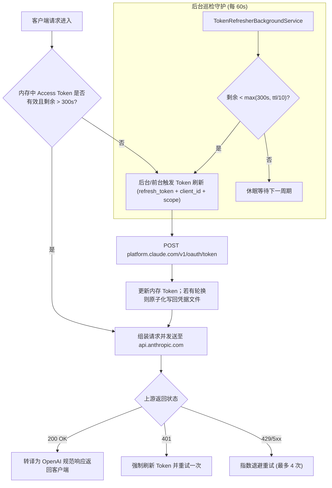

# ClaudeAgent 🚀

> **基于本机 Claude Code 已登录账号的 OpenAI 兼容代理网关与双 Token 永续系统**

ClaudeAgent 是一个专为 AI Agent（Cursor、Dify、LangChain、Cline / Roo Code、Continue、官方 OpenAI SDK 等）打造的高性能本地/私有网关。它读取本机 Claude Code 登录账号的 OAuth 凭据（`~/.claude/.credentials.json`），通过 Claude Code 官方 CLI 的 OAuth client 通道将账号能力转化为完全符合 **OpenAI 官方规范** 的 API 接口（`/v1/chat/completions`、`/v1/models`、`/v1/health`），并以 **refresh token 双 Token 永续机制** 保证 7x24 小时无人值守运行。

> 本项目架构参考同族的 [Antigravity-Agent / GeminiAgent](../Antigravity-Agent)（OpenAI 兼容网关 + 双 Token 永续），并针对 Anthropic OAuth 通道做了完整的逆向分析与实证验证（见 `investigation/`）。

---

## 🌟 核心特性与技术验证

### 1. 🔄 双 Token 机制与自动永续保活（Perpetual Token Lifecycle）

- **无感安全读取**：自动探测 Windows 用户目录下 Claude Code 的凭据文件 `~/.claude/.credentials.json`（`claudeAiOauth` 结构），无需抓包或重新登录；同时兼容扁平结构与显式环境变量（`CLAUDE_REFRESH_TOKEN`，用于 Linux/Docker 无头部署）。
- **OAuth 2.0 双 Token 自动续期**：凭据中的 `refresh_token` + 官方 CLI 公开 `client_id`（`9d1c250a-e61b-44d9-88ed-5944d1962f5e`，逆向自 `claude.exe` 2.1.301），定期向 `https://platform.claude.com/v1/oauth/token` 刷新获得最新 `access_token`。
- **Refresh Token 轮换持久化**：Anthropic 刷新响应可能返回**新的 refresh_token**（服务端轮换）。网关检测到轮换后会把新 refresh_token **原子化写回**凭据文件（临时文件 + `File.Replace`，保留 `.bak`）并同步到网关自身状态文件 `~/.claude/claude-agent-state.json`，避免旧 token 作废导致断供，同时保证 Claude Code CLI 与网关共用同一账号状态。
- **后台主动轮询保活 (`TokenRefresherBackgroundService`)**：每 60 秒巡检，剩余有效时长少于 5 分钟或总时长的 10% 时提前无缝刷新。
- **401 自愈重试**：上游偶发鉴权失效时，网关强制刷新并重试一次，实现真正永续运行。



### 2. ⚡ Anthropic 第一方 OAuth 通道

- 直连 `https://api.anthropic.com/v1/messages`（`anthropic-beta: oauth-2025-04-20`、`anthropic-version: 2023-06-01`、`User-Agent: claude-cli/2.1.301`），这是 Claude Code CLI 同款通道，享受 OAuth 配额而非 API key 计费。
- 流式（SSE）与聚合（非流式）双模式；工具调用、图片（data URI / URL 下载转 base64）、stop 序列、tool_choice 全量映射。
- 模型列表动态发现：启动时与运行期调用 `GET /v1/models` 获取**账号名下全部可用模型**（含日期戳完整 ID 自动生成短别名），失败时回退到内置兜底列表。

### 3. 🧠 深度思考与多轮工具调用适配

- 将 Anthropic 的 `thinking_delta` 流式事件映射为 OpenAI 规范的 `delta.reasoning_content`（与主流 DeepSeek/Qwen 代理一致），并把思考 token 统计进 `usage.completion_tokens_details.reasoning_tokens`。
- 多轮工具调用（tool_use → tool_result 往返）原生支持，官方 OpenAI .NET SDK 多轮回合测试直接通过。

### 4. 🔀 全量模型生态

`/v1/models` 输出账号可用的全部 Claude 模型（动态发现 + 短别名）。**为节省额度，所有实际调用验证均自动选用 Haiku 模型**（模型列表中第一个 `*haiku*`），包括官方 SDK 测试与多轮工具调用往返测试。

---

## 🚀 快速启动指南

### 准备环境
- **操作系统**：Windows 10/11（本机已登录 Claude Code）
- **运行环境**：.NET 10.0 SDK
- **测试环境**：测试套件使用微软官方 `OpenAI` NuGet 包

### 方式 A：前台实时运行
```powershell
.\scripts\start_gateway.ps1 -Port 5055
```

### 方式 B：后台静默守护运行（日常推荐）
```powershell
.\scripts\start_background.ps1 -Port 5055

# 健康检查
curl http://127.0.0.1:5055/v1/health

# 一键停止
.\scripts\stop_gateway.ps1 -Port 5055
```

### 一键执行全量闭环验证
```powershell
.\scripts\verify_all.ps1
```
脚本自动：确保凭据存在 → 按需后台拉起网关 → 编译并执行 .NET 10 xUnit 测试套件（健康检查、模型列举、非流式问答、实时流式 SSE、工具调用、多轮往返、官方 SDK 直连）。

---

## 🐳 Docker / Docker Compose 部署

项目内置多阶段 `Dockerfile`（`src/ClaudeAgent/Dockerfile`）与 `docker-compose.yml`，可将网关以 Linux 容器方式部署（适合服务器/无头环境）。容器内没有 Claude Code CLI，因此**授权信息（Claude Code OAuth refresh token）需要由你首次复制/注入到容器**。双 Token 永续刷新会在容器内独立工作；刷新轮换出的新 token 会持久化到容器内可写卷（`claude-state`），与宿主机 CLI 互不影响。

> ⚠️ **授权信息注入只有两种方式（二选一）**，优先级：**A（env） > B（secret 文件）**。不要同时启用两者；方式 B 必须保证 `CLAUDE_REFRESH_TOKEN` 为空，否则 env 会覆盖文件。

### 1. 准备授权信息（首次如何复制进 Docker）

先在本机提取 Claude Code 的 refresh token：

```powershell
$creds = Get-Content "$env:USERPROFILE\.claude\.credentials.json" -Raw | ConvertFrom-Json
$creds.claudeAiOauth.refreshToken     # 形如 sk-ant-ort01xxxx...
```

#### 方式 A（推荐，永续最稳）：把 refresh token 写入 `.env`

- 容器内无需挂载任何凭据文件，无文件权限问题；刷新轮换后的新 token 由网关写回容器内可写卷（`/app/state`），**token 永续不依赖宿主机**。
- 操作步骤：
  1. `cp .env.example .env`；
  2. `.env` 中填入 refresh token，并确保**取消注释**这两行：
     ```
     CLAUDE_REFRESH_TOKEN=sk-ant-ort01xxxx...
     CLAUDE_AUTH_SOURCE=Env
     ```
  3. `docker-compose.yml` 默认即方式 A（以下三行处于**启用**状态，保持不动即可）：
     ```yaml
     CLAUDE_AUTH_SOURCE: ${CLAUDE_AUTH_SOURCE:-Env}
     CLAUDE_REFRESH_TOKEN: ${CLAUDE_REFRESH_TOKEN:-}
     CLAUDE_OAUTH_SCOPES: ${CLAUDE_OAUTH_SCOPES:-user:file_upload user:inference user:mcp_servers user:plugins user:profile user:sessions:claude_code}
     ```
  4. 同时确保 `CLAUDE_CREDENTIALS_FILE` 与底部 `secrets:` 引用保持**注释**（方式 B 残留会干扰）。
- 效果：网关启动即用 refresh token 换取 access token，并持久化到 `claude-state` 卷；容器重启后从卷内状态续用，token 再也不会"过期漂移"。

#### 方式 B：复制凭据文件 + Docker secret（只读注入）

- 适合希望与宿主机共用同一份完整 `claudeAiOauth` 结构（含 scopes/subscriptionType）的场景。secret 以**只读**方式挂载到容器 `/run/secrets/claude_credentials`，**不进入镜像层**（`.dockerignore` 已排除 `credentials.json`）。
- 操作步骤：
  1. 复制本机凭据到项目根目录：
     ```powershell
     Copy-Item "$env:USERPROFILE\.claude\.credentials.json" .\credentials.json
     ```
  2. 在 `docker-compose.yml` 中：
     - **取消注释** `CLAUDE_CREDENTIALS_FILE: /run/secrets/claude_credentials`；
     - **取消注释** 服务级 `secrets:` 列表与顶层 `secrets:` 定义（顶层 `claude_credentials: {file: ./credentials.json}`，服务级 `- claude_credentials`，二者缺一不可，否则容器内 `/run/secrets/claude_credentials` 不存在）；
     - **注释掉方式 A 的三行**（`CLAUDE_AUTH_SOURCE` / `CLAUDE_REFRESH_TOKEN` / `CLAUDE_OAUTH_SCOPES` env 透传）—— 方式 B 下 env 优先级更高，一旦填写就会覆盖文件来源。
  3. 验证 secret 已挂载：
     ```bash
     sudo docker exec claude-agent ls -l /run/secrets/
     sudo docker exec claude-agent cat /run/secrets/claude_credentials
     ```
- ⚠️ **方式 B 的"凭据漂移"坑（实战踩过）**：Claude Code 的 refresh token 是**单次使用**的 —— 本机 CLI 或宿主机网关每次成功刷新后，服务端会**轮换签发新 token**，旧 token 立即作废 `（invalid_grant: Refresh token not found or invalid）`。你复制进 WSL/服务器的 `credentials.json` 只是当时的一个"快照"，**只要本机再登录/刷新过，这份副本就过期了**。因此方式 B 需要：每次本机刷新过后，重新执行 `Copy-Item` 并 `docker compose up -d`。**若追求长期免维护，请用方式 A。**

### 2. 启动

```bash
cd /path/to/Claude-Agent
cp .env.example .env        # 按需改 GATEWAY_PORT / 代理 / 鉴权 key / 授权方式
docker compose up -d --build
```

> 改过源码/镜像后必须带 `--build`；怀疑构建缓存时用 `docker compose build --no-cache claude-agent` 重建。

### 3. 验证

```bash
curl http://localhost:8080/healthz                       # -> ok
curl http://localhost:8080/v1/models                     # 动态发现的模型列表
curl http://localhost:8080/v1/chat/completions \
  -H 'content-type: application/json' \
  -d '{"model":"claude-haiku-4-5","messages":[{"role":"user","content":"say hi"}]}'
docker compose logs -f claude-agent                      # 观察日志
```

日志中确认授权链路正常的两行：

```
Discovered Claude Code account from <凭据来源> (claudeAiOauth)        # 方式 A 显示 Environment，方式 B 显示 /run/secrets/...
Claude Code token refreshed successfully (valid ~3600s, until ...)   # 刷新成功，双 Token 永续开始工作
```

若看到 `Token refresh failed (400)`，对照下表：

| 报错 message | 含义 | 处理 |
| :--- | :--- | :--- |
| `Invalid request format` / `Invalid JSON body` | 刷新请求格式或 client_id 不对 | 确认镜像内 `appsettings.json` 的 `Auth.ClientId` 是 `9d1c250a-...`（**git init 曾残留占位 `xxx`，会随镜像打进容器**）；确认代码为 `FormUrlEncodedContent` 版本 |
| `invalid_grant` / `Refresh token not found or invalid` | **refresh token 已失效（最常见）** | 方式 A：换新的 `CLAUDE_REFRESH_TOKEN`；方式 B：重新 `Copy-Item` 本机 .credentials.json 并重建 |
| `Client with id ... not found` | client_id 非官方值 | 检查环境变量 `CLAUDE_OAUTH_CLIENT_ID` / appsettings |

### 4. 部署注意事项（重要）

- **镜像内严禁占位脏值**：`appsettings.json` 在早期开发时曾带有 `"ApiKey": "xxx"`、`"ClientId": "xxx"`、`"MetadataAccountId": "xxx"` 占位值，会随镜像打进容器并导致刷新 400。`git init` 后请检查并修正为真实值（ClientId 见上方表格，ApiKey 留空、MetadataAccountId 填真实 account_uuid 或留空）。修改后务必 `docker compose up -d --build --no-cache`。
- **网络出网（本网络必看）**：容器内**没有 Windows 系统代理**。若宿主机直连 `api.anthropic.com` 被封（本机已实证 403），必须给容器设置代理。`docker-compose.yml` 已透传 `HTTPS_PROXY`/`HTTP_PROXY`/`NO_PROXY`，在 `.env` 填入即可（示例为 `http://10.0.5.230:7890`）。若代理宿主机 IP 在容器内不可达（Docker Desktop 的桥接网络），改用 `http://host.docker.internal:7890` 或宿主网卡 IP。**注意**：能在容器内收到带 `request_id` 的 400/429 响应即说明网络已通，无需代理。
- **永续 token 落盘**：容器默认把网关 token 状态写到 `/app/state/claude-agent-state.json`，该目录挂到命名卷 `claude-state`，保证容器重启后 refresh token 不丢失、双 Token 持续轮换。可经 `CLAUDE_STATE_FILE` 调整。
- **方式 B 只读副本无法自愈**：secret 是只读挂载，容器内刷新出的新 token **不会写回** `/run/secrets/claude_credentials`，只落到 `/app/state` 卷。因此方式 B 下容器重启后若 `/app/state` 卷还在，网关仍能从状态文件续用新 token；若卷丢失 + 凭据副本又已过期，就会 `invalid_grant`。这也是推荐方式 A 的根本原因。
- **容器内用户**：`Dockerfile` 以 `root` 运行，便于把凭据文件/卷挂载到 `~/.claude` 或 `/app/state`。若你改为非 root，需自行保证 `/app/state` 可写。
- **端口**：容器监听 `8080`（`ASPNETCORE_URLS=http://+:8080`），宿主机映射端口由 `GATEWAY_PORT` 控制（默认 8080）。Windows 防火墙可能需放行该入站端口。
- **构建需联网**：首次 `docker compose up --build` 需从 `mcr.microsoft.com` 拉取 .NET 10 的 SDK/ASP.NET 基础镜像。本项目零 NuGet 外部依赖，构建阶段无需额外外网。
- **健康检查**：compose 使用 `/healthz` 端点（返回 `ok`），30s 间隔、3 次失败判定 unhealthy。
- **鉴权**：设置 `CLAUDE_API_KEY` 后 `/v1/*` 需携带 `Authorization: Bearer <key>`；未设置则允许任意请求（内网建议设置）。注意 `.env` 里带 `#`/`;` 等特殊字符的值必须用**双引号**包裹（如 `CLAUDE_API_KEY="uW26nO#D3M#D;"`），否则 `#` 之后会被当作注释截断。

---

## 💻 主流 Agent 接入示例

### 1. Cursor / Cline / Roo Code
- **Base URL**：`http://127.0.0.1:5055/v1`
- **API Key**：网关未配置鉴权时任意值即可（appsettings `Gateway:ApiKey` 默认空）；若已配置 `CLAUDE_API_KEY`/`GATEWAY_API_KEY` 环境变量，需填入**同一个 key**（`.env` 中带 `#`/`;` 的值记得加双引号）。
- **Model ID**：`claude-haiku-4-5` / `claude-sonnet-4-5` 等

### 2. 官方 .NET C# OpenAI SDK (NuGet: OpenAI 2.x)
```csharp
var clientOptions = new OpenAIClientOptions { Endpoint = new Uri("http://127.0.0.1:5055/v1") };
var client = new OpenAIClient(new ApiKeyCredential("sk-claude"), clientOptions);
var chatClient = client.GetChatClient("claude-haiku-4-5");

ChatCompletion completion = await chatClient.CompleteChatAsync("9.11 和 9.9 谁更大？");
Console.WriteLine(string.Concat(completion.Content.Select(c => c.Text)));

AsyncCollectionResult<StreamingChatCompletionUpdate> stream =
    chatClient.CompleteChatStreamingAsync("从 1 数到 5");
await foreach (var update in stream)
    foreach (var part in update.ContentUpdate)
        Console.Write(part.Text);
```

### 3. 官方 Python OpenAI SDK
```python
from openai import OpenAI

client = OpenAI(base_url="http://127.0.0.1:5055/v1", api_key="sk-claude")

completion = client.chat.completions.create(
    model="claude-haiku-4-5",
    messages=[{"role": "user", "content": "9.11 和 9.9 谁更大？请给出简短理由。"}]
)
print("回答:", completion.choices[0].message.content)
print("思考 Token:", completion.usage.completion_tokens_details.reasoning_tokens)

stream = client.chat.completions.create(
    model="claude-haiku-4-5",
    messages=[{"role": "user", "content": "用 Python 写一个斐波那契函数"}],
    stream=True,
)
for chunk in stream:
    if chunk.choices[0].delta.content:
        print(chunk.choices[0].delta.content, end="", flush=True)
```

### 4. LangChain 接入
```python
from langchain_openai import ChatOpenAI
llm = ChatOpenAI(
    base_url="http://127.0.0.1:5055/v1",
    api_key="sk-claude",
    model="claude-haiku-4-5",
    temperature=0.2
)
```

---

## ⚙️ 环境变量与高级配置

配置文件位于 `src/ClaudeAgent/appsettings.json`，可被环境变量覆盖（完整列表见 `.env.example`）：

| 环境变量 | 默认值 | 说明 |
| :--- | :--- | :--- |
| `GATEWAY_API_KEY` / `CLAUDE_API_KEY` | *(空)* | 网关对外认证密钥，为空则允许任意请求 |
| `CLAUDE_DEFAULT_MODEL` | `claude-haiku-4-5` | 未指定模型时的默认路由（自动解析到已发现的 Haiku） |
| `CLAUDE_DEFAULT_MAX_TOKENS` | `4096` | Anthropic max_tokens 必填项缺省值 |
| `CLAUDE_WRITEBACK` | `true` | 刷新后是否原子化写回 Claude Code 凭据文件 |
| `CLAUDE_CREDENTIALS_FILE` | `~/.claude/.credentials.json` | 凭据文件路径 |
| `CLAUDE_REFRESH_TOKEN` | *(空)* | 无头部署显式 refresh token（优先级最高） |
| `CLAUDE_OAUTH_CLIENT_ID` | `9d1c250a-e61b-...` | 官方 CLI OAuth client_id |
| `CLAUDE_OAUTH_TOKEN_URL` | `https://platform.claude.com/v1/oauth/token` | OAuth token 端点 |
| `CLAUDE_BASE_URL` | `https://api.anthropic.com` | 上游 API 基础地址 |
| `CLAUDE_ANTHROPIC_BETA` | `oauth-2025-04-20,claude-code-20250219` | OAuth 通道 beta 头 |
| `CLAUDE_USER_AGENT` | `claude-cli/2.1.301 (external, sdk-cli)` | 上游请求 UA（CLI 同款） |
| `CLAUDE_BILLING_SYSTEM_PROMPT` | `x-anthropic-billing-header: ...` | OAuth 通道计费头（system 首块；缺失即全量 429） |
| `CLAUDE_METADATA_DEVICE_ID` | *(自动)* | metadata.user_id 设备标识 |
| `CLAUDE_METADATA_ACCOUNT_ID` | *(自动)* | metadata.user_id 账号标识 |
| `CLAUDE_MESSAGES_QUERY` | `beta=true` | messages 端点查询参数 |
| `CLAUDE_MAX_CONCURRENCY` | `4` | 上游最大并发数 |
| `CLAUDE_MAX_ATTEMPTS` | `4` | 429/5xx/瞬态错误重试次数 |

---

## 🔍 逆向分析与实证验证结论（investigation/）

| 验证项 | 结论 |
| :--- | :--- |
| OAuth Token 端点 | `https://platform.claude.com/v1/oauth/token`（旧版 `console.anthropic.com` 端点已迁移） |
| client_id | `9d1c250a-e61b-44d9-88ed-5944d1962f5e`（prod；`22422756-...` 为 local 调试变体） |
| 刷新请求体 | **`application/x-www-form-urlencoded`**（表单编码），字段 `grant_type=refresh_token&refresh_token=...&client_id=...&scope=...`；**发 JSON 会被判 400 `Invalid request format / Invalid JSON body`**（实测差异：JSON→`Invalid JSON body`，非 UUID 格式 client_id→`Invalid request format`） |
| 刷新响应 | `access_token / refresh_token(可选轮换) / expires_in / scope` |
| 凭据结构 | `~/.claude/.credentials.json` → `claudeAiOauth{accessToken, refreshToken, expiresAt(ms), refreshTokenExpiresAt(ms), scopes[], subscriptionType}` |
| 上游鉴权头 | `Authorization: Bearer` + `anthropic-beta: oauth-2025-04-20,claude-code-20250219` + `User-Agent: claude-cli/<ver> (external, sdk-cli)` |
| **计费头（关键）** | CLI 在 system 提示首块发送 `x-anthropic-billing-header: cc_version=2.1.301.eb5; cc_entrypoint=sdk-cli;`；**缺失会被 Anthropic OAuth 限流器归入最严格桶 → 全部 429**（决定性实验：逐字节重放 CLI 请求 200，去掉计费块 429）。网关自动附加（`Provider.BillingSystemPrompt` 可覆盖） |
| 配额归属 | CLI 同时发送 `metadata.user_id`（内嵌 `device_id/account_uuid/session_id` JSON 字符串）；网关同款附加，device/account 可经环境变量覆盖 |
| 模型参数 | claude 5.x 模型已废弃 `temperature`（发送即 400），网关一律不发送 temperature/top_p |
| 端点形态 | CLI 命中 `/v1/messages?beta=true`，网关同款（`Provider.MessagesQuery`） |
| 401 语义 | 服务器端吊销时返回 `OAuth access token has been revoked`；refresh token 失效时返回 `invalid_grant / Refresh token not found or invalid` |

---

## ❓ 常见问题排查 (FAQ)

### Q1: 提示 `未找到有效的 Claude Code 登录凭据` 或 `invalid_grant`？
说明本机 Claude Code 未登录或 token 已被服务器端吊销（例如账号在其他设备重新登录/登出）。请在终端运行 `claude auth login` 重新登录，网关即可无感读取新凭据。原始凭据会自动备份到 `investigation/credentials.backup.json`。

> **Docker 方式 B 特别注意**：若容器报 `invalid_grant: Refresh token not found or invalid`，通常是 `credentials.json` 副本已过期 —— Claude Code 每次刷新都会**轮换 refresh token 并作废旧值**，过早复制的副本失效。重新 `Copy-Item` 最新凭据并重建容器，或改用方式 A（env 注入）。

### Q1.5: Docker 容器报 `Token refresh failed (400)`，怎么区分原因？
看报错 message：
- `Invalid request format` / `Invalid JSON body` / `Client with id ... not found` → **client_id / 请求格式问题**。先确认镜像内 `appsettings.json` 的 `Auth.ClientId` 是官方值 `9d1c250a-e61b-44d9-88ed-5944d1962f5e`（git init 曾携带占位 `xxx` 并打进镜像），且代码为 `FormUrlEncodedContent` 版本；然后 `docker compose up -d --build --no-cache` 重建。
- `invalid_grant` / `Refresh token not found or invalid` → **refresh token 已失效**。按上一条处理。
- `429 rate_limit_error` → OAuth 端点限流（本地反复手工刷新测试会触发），等几分钟重试；也说明网络和格式都没问题。

### Q2: 登录/请求一直报 403 "Request not allowed"？
本机网络出口被 Anthropic 拒绝直连（已实证）。**Node.js 的 claude.exe 不读 Windows 系统代理**，即使浏览器能正常访问也会 403。解决：
```powershell
$env:HTTPS_PROXY = "http://<代理IP>:<端口>"   # 本机为 10.0.5.230:7890
$env:HTTP_PROXY  = "http://<代理IP>:<端口>"
$env:NO_PROXY    = "localhost,127.0.0.1"
claude auth login
```
建议一并 `setx HTTPS_PROXY ...` / `setx HTTP_PROXY ...` 持久化，此后 claude 与网关都经代理出网。

### Q3: 登录成功但 `claude -p` 仍报 "OAuth session expired and could not be refreshed"？
检查 `%USERPROFILE%\.claude\.credentials.json`：若 `accessToken`/`refreshToken` 为空字符串，说明 CLI 的凭据持久化失败（本机实测出现过：交换成功但凭据被清空）。重跑登录并观察终端是否出现 `credentials could not be saved` 提示；必要时改用 `claude auth login --claudeai` 流程（该流程在 2.1.301 实测可产生真实 token 落盘）。

### Q4: 端口 5055 被占用？
`.\scripts\start_gateway.ps1 -Port 5056`，客户端 Base URL 同步改为 `http://127.0.0.1:5056/v1`。

### Q5: 如何确认双 Token 已经成功自动永续？
访问 `http://127.0.0.1:5055/v1/health`：`remainingSeconds` 会在接近阈值时自动重置回约 3600 秒，且凭据文件 `accessToken` 会被网关自动更新，证明后台保活与 OAuth 刷新工作正常。

### Q6: 所有请求都返回 429 rate_limit_error，但 claude CLI 正常？
这是 OAuth 通道的**客户端分类限流**：Anthropic 只把携带计费头的请求视为 Claude Code 正常流量。本网关已默认在每次上游请求的 system 首块附加 `x-anthropic-billing-header: cc_version=...; cc_entrypoint=sdk-cli;`（CLI 实测抓包确证，见 investigation/INVESTIGATION_NOTES.md）。若自定义了 `CLAUDE_BASE_URL` 指向兼容服务，无需处理；若你自行改造请求体，务必保留该 system 首块。另注意：`metadata.user_id` 与 `?beta=true` 查询参数也应保持 CLI 同款。

### Q7: Python OpenAI SDK 请求返回 502？
该环境的 openai 包依赖读取 Windows 系统代理的 http 变体，会把 `127.0.0.1` 的本地网关请求也转发到系统代理（代理主机上无 127.0.0.1:5055）→ 502。解决：
```powershell
$env:NO_PROXY = "localhost,127.0.0.1"; $env:no_proxy = "localhost,127.0.0.1"
python scripts/verify_python.py
```

### Q8: claude 5.x 模型报 "`temperature` is deprecated for this model"？
claude 5.x 已废弃 temperature（含 haiku-5-5/sonnet-5-5/opus-5-5）。本网关已默认不向 Anthropic 上游发送 temperature/top_p，客户端仍可按 OpenAI 规范传值（会被忽略）。

---

## 📄 开源许可证

MIT License
